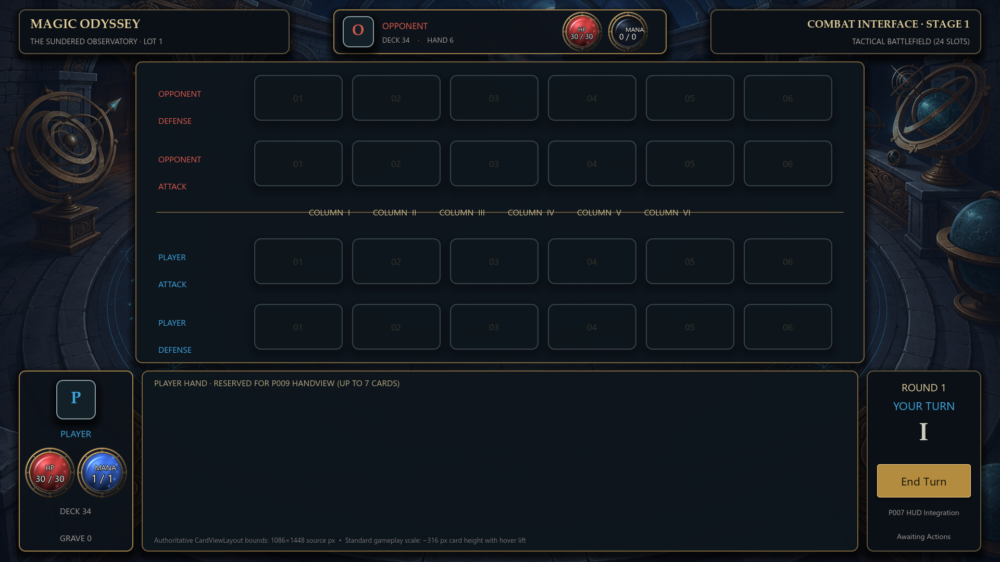
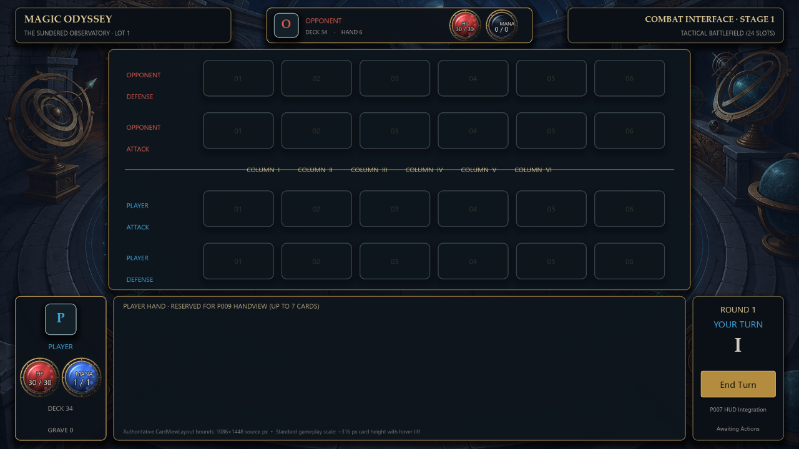
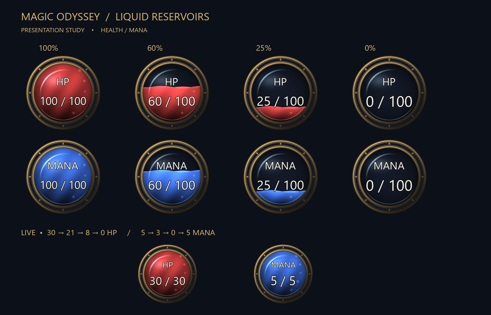

# P005-R01 — Animated liquid Health and Mana orbs

Date: 2026-11-14. Godot 4.7.2 stable. Windows, OpenGL Compatibility, NVIDIA GeForce GTX 1660 Ti.

**Technical result: PASS. Artistic recommendation: KEEP_WITH_ADJUSTMENTS. Owner approval pending.**

Four independent animated reservoirs replace the primary HP/Mana text in CombatScreen. The battlefield, all four rows and their 24 guides, hand capacity, action area, responsive transform and existing accessors retain their geometry and behavior. P006–P010 have not been implemented.

## 1. Unity bar16 reference analysis

Inspected, read-only, under `D:\Dev\Unity\SevenBattles\Assets\HealthBar`:

- `bars/bar16/bar16.prefab`, `health16.mat`, `front.png`, `line.png`, `lineMask.png`, `bubbles.png`.
- `FMAWaveHealhtBarUI.shader`, `Scripts/MaterialHealhBar.cs`, `Scripts/HealthBarLogic.cs`.

The prefab draws a 600×600 liquid Image first, then a 754×975 foreground Image with the sculpted housing and baked glass reflections. The parent is 795.6×1006.8. The foreground is artwork, not a physically simulated glass shader. The liquid sprite is red. The mask is a black-to-white vertical gradient, not a circular silhouette; the foreground covers its unused area.

`MaterialHealhBar.Value` clamps the requested value to [0,1], remaps it through Min/Max and calls the referenced material's float setter. Both Min=0 and Max=1 in bar16; the prefab sample is 0.565, while the saved material value is 1. `Start` and `Update` synchronize the serialized value when it changes. The inspected script neither smooths the fill nor creates an independent material for every UI instance.

The shader averages three horizontally offset red-channel mask samples. Two time-driven trigonometric thresholds turn that gradient into moving surfaces. Their phases, directions, spatial scales and speeds differ; the second temporal rate is 0.77 of the first and its spatial scale is 0.7. Thresholds use smoothstep around the inverse fill. Liquid alpha combines both layers; their contributions also modulate brightness. The first amplitude tapers with distance to the endpoints; the second uses a different envelope.

Actual material parameters:

| Parameter | bar16 material | Meaning in the inspected shader |
|---|---:|---|
| `_Value` | 1 | Normalized liquid threshold |
| `_WaveAmplitude` | 0.0622 | Surface displacement scale |
| `_WaveFrequency` | 63.6 | Time multiplier, despite its name |
| `_WaveSize` | 8.8 | Horizontal wave scale |
| Bubble tiling | 1.5 × 1.5799872 | Repeated bubble texture |

Bubble UVs scroll vertically and wobble horizontally. White bubble texture samples brighten the liquid. The UI shader uses standard source-alpha transparency, stencil support, and disables depth writing/testing in its pass. The package is a layered material effect, not fluid physics.

## 2. Features reproduced

Normalized vertical fill, two independently phased waves, a brighter meniscus, layered liquid shading, rising bubbles, glass reflections and a separate-looking metal/glass composition are reproduced with original analytic Godot rendering. Resource values can change continuously at runtime. Red and blue share one rendering implementation and match the existing theme's HP/Mana colors.

## 3. Features intentionally omitted

No third-party imagery, copied shader text, Unity UI/stencil implementation, prefab dimensions, texture-based fill masks, or shared mutable Unity material behavior. No fluid physics, bloom, refraction of the scene background, gameplay timers or gameplay binding. The Unity's painted sculptural complexity has not been recreated by the procedural metal ring.

## 4. Licensing findings

The package was searched for license, attribution, README, EULA and documentation filenames, including text/PDF/Markdown/HTML files. No applicable license or attribution document was found within `Assets/HealthBar`; a broader filename search under `Assets` did not establish rights for this package. Usage rights remain unconfirmed. No Unity source or imagery was copied into this repository. Unity files were only read/viewed. The Godot shader and component were independently written for this task; their only runtime dependencies are existing Godot/theme resources.

## 5. Component architecture and files

| File | Responsibility |
|---|---|
| `scenes/hud/liquid_resource_orb.tscn` | Reusable Control, reservoir and two readable labels |
| `scripts/presentation/liquid_resource_orb.gd` | Typed resource kind, normalized values, independent material, transition state and layout |
| `resources/shaders/liquid_resource_orb.gdshader` | Original GPU reservoir, glass, waves, bubbles and housing |
| `scenes/hud/liquid_orbs_demo.tscn`, `scripts/presentation/liquid_orbs_demo.gd` | Presentation-only static gallery and looping live demonstration |
| `scenes/combat/combat_screen.tscn`, `scripts/presentation/combat_screen.gd` | Four instances and four additional typed accessors |
| `scripts/tests/test_liquid_resource_orb.gd`, `test_runner.gd` | Dedicated suite and native registration |
| `scripts/tests/capture_p005_r01.gd` | GPU screenshots, timed transition assertions and raw animation captures |
| `docs/progress/lot1-progress.md`, this directory | Progress and review evidence |

API: `set_resource_kind`, `set_resource_values`, `get_visible_fill_ratio`, `set_animation_enabled`. Labels update immediately. Maximum ≤0 becomes 0/0 and empty; negative current clamps to zero; current above maximum clamps to maximum. ResourceKind is a typed HEALTH/MANA enum. There are no domain imports or mutations.

The root accepts rectangular sizes and centers a square reservoir using its smaller dimension. Text fits inside the glass using actual font metrics and outline clearance. Theme colors, bronze and typography come from the existing design tokens/theme. Exact labels remain visible at empty fill.

## 6. Shader design

An antialiased radial mask contains the liquid within a usable glass radius of 0.375 UV units. The level ranges from UV y=0.125 at full to y=0.875 at empty. Thus 50% places the surface at y=0.5. Two sine layers use different directions, frequencies, phases and speeds. Amplitude fades near the endpoints; a zero-fill gate removes all liquid and bubbles at zero. Depth shading darkens the lower fluid and the curved boundary. Seven analytic bubbles rise with fixed individual seeds and rates, without texture generation or CPU particle nodes.

The shader exposes fill, clock, amplitude, frequency, speed, liquid/bronze/enamel colors and response parameters. Broad soft light, a curved reflection and a lower rim reflection remain when empty. Engraved bronze bands, enamel insets and small studs provide a reusable housing. The shader has no dependency on global TIME: each instance receives its own presentation clock.

## 7. Independent materials

Each orb constructs exactly one ShaderMaterial. Only the immutable Shader resource is shared. Tests update player Health and verify all three other visible ratios and material fill uniforms remain unchanged. Palette changes are independent as well. The component does not duplicate materials per frame or per value update.

## 8. Animation and evidence

Fill transitions last 0.28 seconds and use smoothstep from the currently visible level. A fresh update replaces the destination without a discontinuity. Repeating the same destination does not restart the transition. No Tweens or gameplay timers are created. Health loss produces a restrained ruby pulse; restoration brightens subtly. Mana restoration additionally sweeps a brief blue shimmer across the glass. Mana consumption lowers the surface with a short blue response.

Disabling animation stops processing, resets the local clock/response and snaps to the latest target. Two GPU renders separated in time were bit-identical in this mode. Re-enabling resumes visual movement.

The GPU script records 48 real rendered frames with actual frame progression and timed waits, exercising Health 30→21→8→0 and Mana 5→3→0→5. It verifies intermediate ratios, settled ratios, immediate exact labels, rapid interruption and repeated destinations. At fixed 60% Health, two GPU images separated by 0.35 seconds differ in the liquid region while the fill stays constant. Endpoint pixel probes verify liquid at the top/bottom when full, empty at zero, and unchanged background at a sampled point outside the circle. These are sampled GPU checks, not an exhaustive proof for every pixel or renderer.

- [Animation GIF](liquid_orbs_animation.gif): 48 Godot GPU frames encoded with existing local Pillow, displayed at an illustrative 85 ms/frame. No screenshot was painted or mocked externally. Pillow is not a game dependency.
- [Transition sheet](liquid_orbs_animation_frames.png): first sampled frame of each step above, settled frame below. Numbers intentionally show the new exact value before the surface settles.
- [Recorded visible ratios](animation_samples.csv).
- [Fixed-level motion A](motion_a.png), [motion B](motion_b.png).

## 9. 1080p integration



Player orbs occupy 100×100 each within the existing 220×348 hero panel. Opponent orbs occupy 80×80 within its existing 640×86 panel. The provisional 60–70 px opponent diameter was increased to 80 for readability without changing zone geometry. Only opponent title/counter positions were locally adjusted to reserve their space. Placeholder named hero identity was replaced by the neutral OPPONENT label.

## 10. 720p integration



The existing proportional layout remains 2/3 scale: approximately 66.7 px player orbs and 53.3 px opponent orbs. Captures were inspected at their actual dimensions. Exact values are distinguishable with a dark outline and do not touch the metal rim; the opponent numerals are small and remain a readability limitation for owner review. Larger numerals on an adjacent plaque are a possible subsequent art adjustment, without sacrificing board/hand space.

## 11. Multiple fill states and comparison



Compared directly with the preserved [P005 720p image](../p005/combat_screen_720p.png), the HUD now communicates approximate reserves through colored fluid volume and exact quantities through numbers. The two resources gain glass depth and restrained motion. The arena and tactical geometry are unchanged. Previous P005 images have not been overwritten. The standalone gallery includes 100%/60%/25%/0% for both variants; its live row cycles only when run live, and is intentionally frozen in this static capture.

## 12. Tests and execution evidence

Run from the repository root in PowerShell (`$GodotExe = 'D:\Temp\Godot_v4.7.2-stable_win64.exe'`):

| Command | Actual result | Exit |
|---|---|---:|
| `& $GodotExe --headless --path . --editor --import` | Import/class registration successful | 0 |
| `& $GodotExe --headless --path . --script res://scripts/tests/test_runner.gd` | **263 passed, 0 failed**, including all 208 prior assertions and 55 orb assertions | 0 |
| `& $GodotExe --headless --path . res://scenes/combat/combat_screen.tscn --quit-after 3` | Scene initialized without errors | 0 |
| `& $GodotExe --path . --script res://scripts/tests/capture_p005_r01.gd` | Both resolutions, gallery, 48 frames and all timed/GPU checks PASS | 0 |
| `powershell -NoProfile -ExecutionPolicy Bypass -File scripts/tests/run_visual_regression.ps1` | All 3 ART-002 scenes bit-exact; **0 differing pixels** in each | 0 |
| `& $GodotExe --path . res://scenes/hud/liquid_orbs_demo.tscn --resolution 1400x900 --quit-after 330 --fixed-fps 60` | Standalone live scene ran through its sample cycle without errors | 0 |
| `git diff --check` and `git diff --cached --check` | No whitespace errors | 0 |

Full final outputs: [import](import.log), [native tests](tests.log), [scene initialization](init.log), [standalone live scene](live.log), [GPU/animation](gpu.log), [ART-002](art002.log). No final Godot warning or error was emitted by these runs. Git staging emitted LF-to-CRLF normalization warnings under the existing repository configuration; both diff checks passed. The review logs are intentionally versioned as task evidence despite the general log ignore rule. An earlier test launch before importing the new global test class failed to resolve its type (exit 1); importing registered it and the subsequent suite passed. An initial visual review caught three-digit gallery numbers touching the rim; font fitting was added and captures regenerated.

The dedicated suite covers initialization, both kinds, zero/full/intermediate/quarter fill, invalid maxima/current values, repeated updates, disabled/re-enabled animation, non-square resize, two-/three-digit fitting, four-instance integration, containment and independent mutable materials. Existing P005 and ART-002 test files/assertions were preserved.

To view the live study:

```powershell
& $GodotExe --path . res://scenes/hud/liquid_orbs_demo.tscn --resolution 1400x900
```

GPU raw animation PNGs are written to `$env:TEMP\magicodyssey-p005-r01-frames`. The maintained capture script runs outside the historical reviews `.gdignore` boundary. The PNG sheet and CSV can be regenerated without external packages; the GIF is an optional encoding of those same GPU frames.

## 13. Performance considerations

Four small canvas draws plus labels; one material per orb; seven constant analytic bubble iterations per fragment. CPU work is a clock uniform write and, during transitions only, scalar interpolation and response updates. Numeric measurement/layout runs on value/kind/size changes, not each frame. No texture updates, per-frame image creation in the production component, particle nodes, accumulated Tweens, or background tasks. Nodes own all state and release it on free. GPU readback/PNG allocation belongs only to the capture tool. A representative crowded battle/FX benchmark and low-end hardware profiling were **NOT_RUN**; no frame-rate guarantee is claimed from these capture runs.

## 14. Artistic assessment

The radial clipping, dual surfaces, saturated upper fluid, dark lower depth, moving bubbles and persistent glass reflection make this a convincing functional liquid reservoir. Red/blue variants form one family and the empty state remains unambiguous. There is no rectangular spill or excessive bloom in the inspected images.

The metal housing is a clean procedural engraved ring. It does **not** achieve the sculpted, authored material richness of ART-002 or Unity bar16. Bespoke original premium frame artwork is still needed to meet that particular AAA benchmark. The review does not grant final artistic approval.

## 15. Remaining limitations

- Owner artistic approval is pending; procedural housing needs a bespoke art pass.
- Opponent numerals at 720p are small; inspect at the owner's normal viewing distance before approval.
- Bubbles and waves deliberately stay subtle at HUD scale; wave amplitude disappears at exact full/empty endpoints.
- HP/Mana are injected presentation values only. P007 gameplay/view-model binding remains TODO.
- No other GPU backends, DPI configurations, low-end hardware or full combat FX stress run was tested.
- The existing battlefield background remains ART-001 WIP, and existing unrelated layout annotations remain historical P005 content.

## 16. Recommendation

**KEEP_WITH_ADJUSTMENTS**: retain the independent component and liquid behavior, review the genuine captures/live study with the owner, and commission an original sculpted housing before claiming AAA art sign-off. This revision is ready for owner artistic review. Stop after P005-R01; P006 is unchanged and remains TODO.
