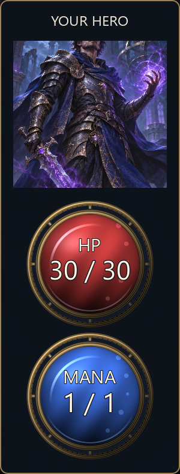
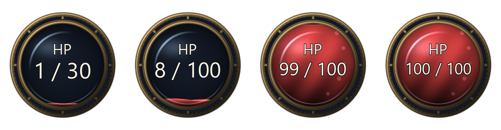
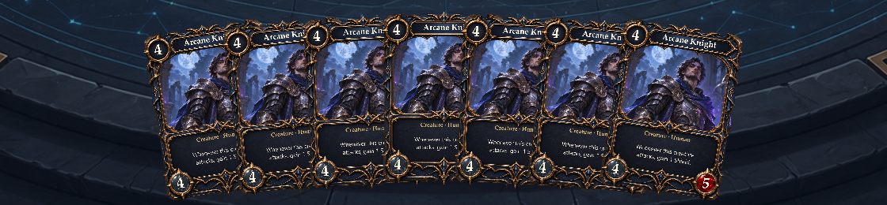
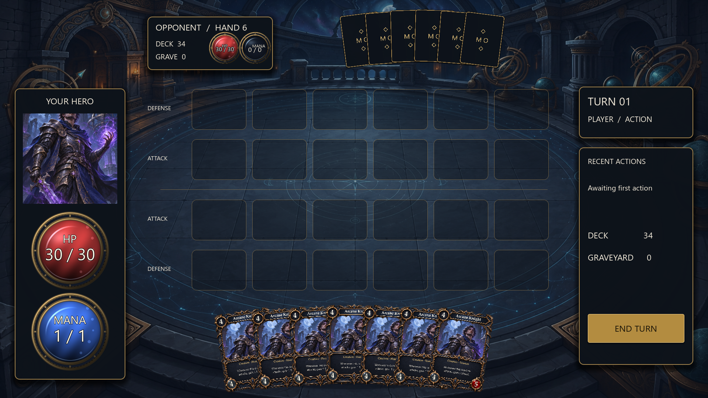

# P005-R02 — CombatScreen composition and Windows preview

2026-11-15 · Godot 4.7.2 stable · Windows · OpenGL Compatibility · NVIDIA GTX 1660 Ti.

**Technical result: PASS. Recommendation: KEEP_WITH_ADJUSTMENTS. Owner artistic approval pending.**

The real CombatScreen now opens directly from a standalone Windows executable. The composition uses a dedicated player hero column, a smaller central battlefield, a light opponent region, a right utility column and a compact player fan. No combat rules, interactive slots, hover/drag behavior or domain classes were added. Stop after P005-R02; P006 remains TODO.

## Previous layout and composition principles

P005/P005-R01 reserved most of the width for the board and a large rectangular bottom region for the hand. Player orbs were 100 px and therefore about 67 px at 720p. Large heading banners, numbered guides and layout annotations competed with the battlefield.

R02 removes the visible match banner and guide numbers. The observatory remains visible through restrained bronze tactical outlines. The five regions have distinct roles, with full-screen background and proportional presentation scaling. Existing typed CombatScreen accessors and row paths remain available for P006–P010. The historical MatchHeader accessor returns an intentionally hidden compatibility node.

The requested reference image was not attached; the supplied written composition direction was used. No new production artwork was generated. The approved card frame, artwork, shared card components and global theme were not redesigned.

## Left hero column and resource readability

The 300 × 790 reference-space column contains only a name, portrait and two liquid resources. The portrait reuses the existing Arcane Knight test illustration and is a presentation sample, not a newly approved hero portrait. No hero power, crystal or extra resource panel exists.

Player orbs are 220 × 220 at 1080p and approximately 147 × 147 at 720p, versus the old 100/67 px. Their original independent materials, liquid animation, glass and exact values are retained. The value label moves upward from a center at 60.5% of the reservoir height to 53%; the resource caption occupies the upper interior. The circular reservoir itself remains centered from its actual bounds. Both labels share the reservoir's horizontal axis; there are no digit-specific offsets.

Font-width fitting is preserved. The additional GPU gallery exercises `1 / 30`, `8 / 100`, `99 / 100` and `100 / 100`, with font measurement and horizontal-axis assertions. This is layout measurement and visual inspection, not a claim of exact glyph-ink centroid measurement.





## Central battlefield

The reserved battlefield is 1120 × 560 reference pixels. Four rows retain six positions each, ordered Opponent Defense, Opponent Attack, Player Attack and Player Defense. Each future position reserves 148 × 110 reference pixels, with 16 px column gaps. A thin center line separates camps. One small role label per row replaces repeated explanations and numbered markers.

These are noninteractive presentation reservations. They do not establish P008 token geometry or implement P006 selection. The background remains the existing ART-001 WIP observatory; its painted geometry is unchanged.

## Right utility column

Turn and phase occupy a separate compact top block. Below, one short recent-action message, deck/graveyard counters and End Turn form the utility column. End Turn retains the existing PrimaryButton theme and focus behavior, with no gameplay callback. All numbers and messages are illustrative presentation values, not live P007 bindings.

## Opponent hand

Six static backs occupy a compact spread above the battlefield. Backs use the existing enamel/bronze theme with a typographic emblem. They contain no face TextureRect, title, rules or stats. GPU checks verify six backs and absence of face textures. The adjacent identity panel displays the hand count, opponent resources and deck/graveyard counts.

## Player hand

Seven static Arcane Knight samples overlap in a curved fan. Cards reuse the existing master v03, portrait crop, full title/rules overlay and creature stat overlay without changing those components. Repetition deliberately demonstrates capacity rather than inventing a catalog or initial deal.

The idle hand region is 1120 × 230, reduced from the old 348 px scene height. Each card is 220 px high, with a 96 px center spacing and a small rotation/vertical arc. At 720p the hand is approximately 153 px high. No parent clips the fan, leaving future upward lift possible. Rotated card corners are checked against the actual viewport. The static sample builder is separate from future P009 HandView behavior.



## 1080p capture

Genuine Godot SubViewport rendering, captured and inspected at 1920 × 1080:



## 720p capture

Genuine Godot rendering at 1280 × 720, captured and inspected at native image size. All 24 outlines, player HP/Mana, two hands, counters and End Turn remain inside the viewport. Player values are readable; small opponent values and individual card text remain less comfortable at this size. The fan communicates identity and capacity rather than providing full rule-text readability without future inspection.


## Windows Standalone Playtest

- Godot: **4.7.2.stable.official.ed1daf0bf**.
- Export preset: **Windows Desktop**, Windows x86_64 release, OpenGL Compatibility.
- Export configuration: repository `export_presets.cfg`; all project resources exported, docs/build output excluded; PCK embedded in the executable; console wrapper disabled. SystemFont fallback uses standard Windows fonts and Godot's built-in fallback; no separate custom font installation is required.
- Entry point: `res://scenes/combat/combat_preview.tscn`, containing the actual reusable CombatScreen and a small preview-specific input/window policy.
- Executable: **`D:\Dev\MagicOdyssey\build\windows\MagicOdyssey.exe`**. Generated builds are ignored by Git. The EXE embeds the release runtime and project assets; no Unity dependency or Godot editor process is used.
- Export exit code: **0**, with the executable actually present. See [export output](export.txt).

Reproduce from `D:\Dev\MagicOdyssey` in PowerShell:

```powershell
New-Item -ItemType Directory -Force build/windows | Out-Null
& 'D:\Temp\Godot_v4.7.2-stable_win64_console.exe' --headless --path . --export-release 'Windows Desktop' build/windows/MagicOdyssey.exe
```

Or use the checked-in wrapper, which verifies the preset name, creates the output directory and propagates the export exit code:

```powershell
powershell -NoProfile -ExecutionPolicy Bypass -File scripts/build_windows.ps1
```

The matching official Windows templates were initially absent. They were downloaded from the [official 4.7.2 release](https://godotengine.org/download/archive/4.7.2-stable/) and installed under `%APPDATA%\Godot\export_templates\4.7.2.stable\` (`windows_release_x86_64.exe`, `windows_debug_x86_64.exe`, `version.txt`). On another build PC install matching templates using Godot's Manage Export Templates before running the command. Templates/editor are needed to build, not to play. [Godot export documentation](https://docs.godotengine.org/en/4.7/tutorials/export/exporting_projects.html).

To play, double-click `build\windows\MagicOdyssey.exe` in Explorer. It opens directly into the rendered battlefield, without a menu. The default is windowed and adapts the 1920 × 1080 request to the available work area, allowing for borders and taskbar. On this desktop the default client was **1888 × 956**. Minimum review support is 1280 × 720; smaller desktops are not covered by this milestone.

ESC uses Godot's built-in `ui_cancel` action in the preview entry node's `_input`. The input is marked handled and `SceneTree.quit(0)` is requested immediately. There is no confirmation or gameplay dependency. Reusable CombatScreen has no unconditional quit handler. Run the preview scene with F6, or F5 through the current main scene, for the same policy; future gameplay can replace the entry point without inheriting ESC-to-quit.

Actual desktop verification used Windows ShellExecute (`UseShellExecute=true`, the same launch mechanism used for an Explorer executable), followed by real OS ESC key-down/up events. This was automated desktop input, not a human double-click session. Only the EXE was copied into a fresh temporary directory and run there, without project files, PCK sidecars or an editor process. The test waits for `COMBAT_PREVIEW_READY` after actual scene frames before collecting client-area screenshots from the real desktop, then checks process exit codes and runtime logs. Stdout flushing is enabled for this preview milestone so the readiness message is observable during release execution.

| Launch | Actual client size | Actual result | ESC exit |
|---|---|---|---:|
| Isolated EXE, default window | 1888 × 956 | Real CombatScreen; all regions visible | 0 |
| Isolated EXE, exact 1080p review window | 1920 × 1080 | All 24 positions, both hands, player HP/Mana and utility controls visible | 0 |
| Isolated EXE, exact 720p review window | 1280 × 720 | Same regions visible, no clipping | 0 |
| Source preview scene through Godot runtime | 1888 × 956 | Same actual scene and preview input policy | 0 |

Final runs emitted **no Godot errors or missing-resource warnings**, and left **no MagicOdyssey processes**. [Standalone desktop results](desktop.txt), [runtime logs](desktop-runtime.txt), [source preview result](editor-preview.txt), [executable size and SHA256](build-artifact.txt). The editor's F5/F6 buttons themselves were NOT_RUN; the source preview scene was launched through the Godot command line and closed with a real ESC event. A clean second PC/Windows VM without the editor installed was NOT_RUN; isolation of the single release EXE was verified locally.

Exact-size review mode is ordinary borderless windowed mode, never exclusive fullscreen:

```powershell
& '.\build\windows\MagicOdyssey.exe' -- --preview-size=1920x1080
& '.\build\windows\MagicOdyssey.exe' -- --preview-size=1280x720
powershell -NoProfile -ExecutionPolicy Bypass -File scripts/tests/playtest_windows.ps1
powershell -NoProfile -ExecutionPolicy Bypass -File scripts/tests/playtest_windows.ps1 -Executable D:\Temp\Godot_v4.7.2-stable_win64.exe -EditorPreview
```

The test asserts the actual Win32 client dimensions; desktop screenshots were inspected at both sizes. [1920 × 1080 desktop](desktop-1920x1080.png), [1280 × 720 desktop](desktop-1280x720.png), [default desktop](desktop-default.png).

An initial scene-only export returned 0 but omitted script-preloaded dependencies. The isolated run caught the missing resources, so it was rejected. The final preset exports all resources and the isolated playtests passed. An intermediate test also caught the preview's size adaptation overriding engine CLI sizes; the explicit review-only user argument above resolves that and the final test checks actual dimensions.

## Validation results

All commands below ran from the repository root. `$GodotExe` denotes `D:\Temp\Godot_v4.7.2-stable_win64_console.exe`.

| Command | Actual result | Exit |
|---|---|---:|
| `& $GodotExe --headless --path . --editor --import` | Final import successful, no warning/error | 0 |
| `& $GodotExe --headless --path . --script res://scripts/tests/test_runner.gd` | 266 passed, 0 failed; includes CombatScreen and liquid-orb suites | 0 |
| `& $GodotExe --path . --script res://scripts/tests/capture_p005_r02.gd` | Both resolutions, zone/guide containment, rotated fan corners, hidden opponent faces, resource fitting and all PNG writes PASS | 0 |
| `powershell -NoProfile -ExecutionPolicy Bypass -File scripts/tests/run_visual_regression.ps1` | ART-002: 3/3 bit-exact, 0 differing pixels | 0 |
| `powershell -NoProfile -ExecutionPolicy Bypass -File scripts/build_windows.ps1` | Release EXE generated | 0 |
| `powershell -NoProfile -ExecutionPolicy Bypass -File scripts/tests/playtest_windows.ps1` | Three isolated launches; true client sizes; ESC 0; no remaining game process | 0 |
| Same desktop script with `-Executable ...Godot_v4.7.2-stable_win64.exe -EditorPreview` | Source scene desktop launch and ESC 0 | 0 |
| `git diff --check` | No whitespace errors | 0 |

Evidence: [import](import.txt), [native tests](tests.txt), [GPU checks](gpu.txt), [ART-002 regression](art002.txt), [export](export.txt), [desktop](desktop.txt). An initial import restored a missing historical `capture_p005.gd.uid` sidecar from cache; the final import was clean. Graph lookup/coverage was consulted but did not supply current GDScript symbols, so implementation was inspected directly from source.

## Changed files

- `scenes/combat/combat_screen.tscn`: five-region composition and static tactical outlines.
- `scripts/presentation/liquid_resource_orb.gd`: centered interior label arrangement.
- `scripts/presentation/combat_preview_cards.gd`: static face/back presentation samples, no interaction.
- `scenes/combat/combat_preview.tscn`, `scripts/presentation/combat_preview.gd`, `project.godot`: direct startup and scoped window/ESC policy.
- `export_presets.cfg`, `scripts/build_windows.ps1`, `.gitignore`: reproducible export and generated-output exclusion.
- `scripts/tests/test_combat_screen.gd`, `capture_p005_r02.gd`, `playtest_windows.ps1`: revised geometry contracts, GPU evidence and actual desktop tests.
- Script UID sidecars, this review directory and `docs/progress/lot1-progress.md`: review evidence and tracking.

The existing showcase, orb gallery, card fixture and regression scenes remain directly launchable by their original paths. Native tests and ART-002 regression remain green.

## Limitations and recommendation

**KEEP_WITH_ADJUSTMENTS.** The hierarchy and player resources are substantially clearer, and the executable is ready for desktop review. This does not establish AAA artwork approval. The hero portrait is reused test art, backs are restrained theme-based samples, opponent numerals remain small at 720p, and seven overlapped sample cards cannot expose all rule text at idle. A future owner-reviewed art pass and P009 inspection/interaction remain necessary.

No live combat, deck handling, log events, End Turn logic, P006 interaction or P007 data binding exists. No second GPU, clean target VM, other DPI setting, low-end performance benchmark or future crowded-token occupancy review was run. Human owner review is pending; P006 has not been started.
