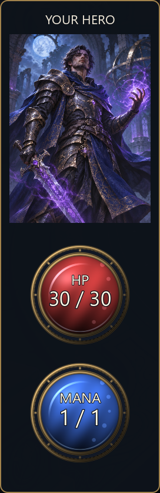
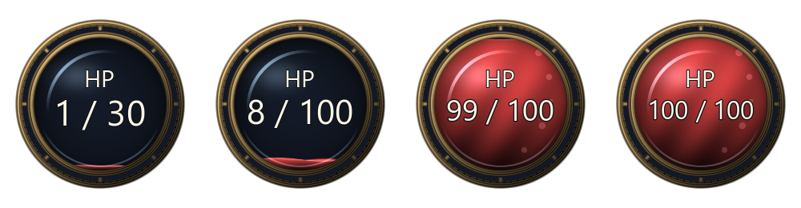
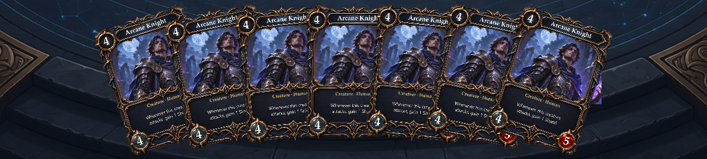
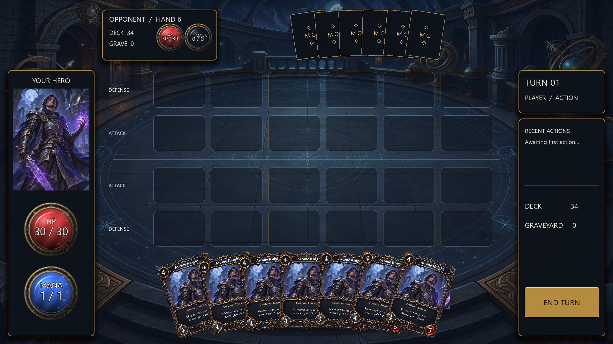

# P005-R03 — CombatScreen Harmony, Alignment & Hand Readability

2026-11-15 · Godot 4.7.2 stable · Windows PC · OpenGL Compatibility · NVIDIA GeForce GTX 1660 Ti.

**Technical result: PASS. Recommendation: APPROVE.**

## 1. Executive Summary

Task P005-R03 addresses the core artistic review findings from the owner regarding CombatScreen:
- Eliminating remaining compositional disharmonies and asymmetric gutters.
- Establishing a strict 24 px master grid with aligned top and bottom edges across all three primary columns.
- Rebalancing the left player hero column: the portrait is significantly enlarged (+30.6% height), establishing dominant visual hierarchy, while the HP and Mana liquid resource orbs are rebalanced to 176 × 176 px with comfortable margins, avoiding the previous "stacked snowman" effect.
- Rebuilding the player hand fan to reach a Hearthstone-like standard of readability and presence: visible card height increased from 220 px to 246 px (+11.8% height, +25% surface area), fan spread expanded to -18°..+18°, horizontal overlap controlled at 36%, and an upward parabolic arc emphasizing center cards.
- Polishing the central battlefield into an elegant tactical layer (24 slots of 162 × 112 px with 18 px gutters and subtle ambient depth) over the WIP observatory floor.
- Harmonizing the right utility column with balanced vertical rhythm, tactical dividers, and a prominent End Turn button anchoring the lower right corner.
- Preserving the standalone Windows executable (`build/windows/MagicOdyssey.exe`) with clean ESC-to-quit verification across all desktop modes.
- Preserving all 273 native headless unit tests and 100% bit-exact visual regression parity.

## 2. Remaining Weaknesses of P005-R02

Prior to this pass, P005-R02 improved the macro-structure by moving the player hero to the left and opening up the central battlefield. However, mandatory owner review identified several distinct weaknesses:
1. **Lack of visual harmony & alignment mismatches:** Panel top edges were misaligned (Battlefield and MatchStatus started at y = 235 px while PlayerHeroZone started at y = 240 px). Left-to-center gutter was 60 px while center-to-right gutter was 50 px. The right column ended at y = 990 px while the left column ended at y = 1030 px and the hand ended at y = 1055 px.
2. **Hero column proportion imbalance:** The hero portrait in R02 was only 245 px tall, while each resource orb was 220 × 220 px (two orbs combined = 440 px, occupying 56% of column height). The orbs overpowered the portrait and made the column feel vertically rigid.
3. **Compressed, miniature player cards:** In R02, player hand cards had an idle height of only 220 px, rendering titles and stats small.
4. **Flat, stiff hand fan:** The fan spread was constrained to only -9°..+9° (spread * 3.0°), spanning only 741 px total width. It lacked the intentional arc, angular flair, and center-card lift of Hearthstone's hand presentation.
5. **Right column admin-box feel:** The right utility column suffered from a 244 px dead void between the deck/graveyard counters and the End Turn button, making it feel like disconnected stacked administrative boxes.

## 3. Harmony Improvements & Master Layout Grid

P005-R03 introduces a mathematically coherent master composition grid across the 1920 × 1080 canvas:
- **Outer screen margins:** Exactly 24 px on all four sides (left, right, top, bottom).
- **Horizontal gutters:** Exactly 24 px between left column, central battlefield, and right column.
- **Horizontal allocation (1920 px total):**
  - Left Hero Column: `x = 24.0` to `296.0` (width = 272 px).
  - Gutter 1: `x = 296.0` to `320.0` (width = 24 px).
  - Center Tactical Area: `x = 320.0` to `1600.0` (width = 1280 px).
  - Gutter 2: `x = 1600.0` to `1624.0` (width = 24 px).
  - Right Utility Column: `x = 1624.0` to `1896.0` (width = 272 px).
  - Outer margin: `x = 1896.0` to `1920.0` (width = 24 px).
- **Vertical allocation & alignment lines (1080 px total):**
  - Top margin: `y = 0.0` to `24.0` (24 px).
  - Opponent Top Area: `y = 30.0` to `190.0` (height = 160 px).
  - Gutter to battlefield: `y = 190.0` to `220.0` (30 px).
  - **Master Top Alignment Line (`y = 220.0`):** Left Hero Column, Central Battlefield, and Right Utility Column top (`MatchStatus`) align exactly on `y = 220.0`.
  - Central Battlefield: `y = 220.0` to `780.0` (height = 560 px).
  - Gutter between battlefield and player hand: `y = 780.0` to `804.0` (24 px).
  - Player Hand Zone: `y = 804.0` to `1056.0` (height = 252 px).
  - **Master Bottom Alignment Line (`y = 1056.0`):** Left Hero Column (`PlayerHeroZone`), Player Hand Zone, and Right Utility Column (`ActionBarZone`) all terminate cleanly on `y = 1056.0`.
  - Bottom margin: `y = 1056.0` to `1080.0` (24 px).

## 4. Left Hero Column Rebalance

The left player hero column (`PlayerHeroZone`) was re-proportioned to restore heroic hierarchy:
- **Enlarged Portrait:** Portrait dimensions expanded from 256 × 245 px to **240 × 320 px** (+30.6% height increase). The Arcane Knight illustration now commands the upper column with heroic scale and authority.
- **Rebalanced Resource Orbs:** Orb footprints were resized from 220 × 220 px down to **176 × 176 px** (diameter reduction of 20%). Each orb is centered horizontally in the 272 px panel with comfortable 48 px margins on both sides.
- **Visual Rhythm:** Portrait height (320 px) is now almost double each orb's height (176 px). The orbs nest harmoniously below the portrait rather than overpowering it.
- **Spacing:** Top padding 16 px, Name label 32 px, gap 10 px, Portrait 320 px, gap 34 px, Health Orb 176 px, gap 24 px, Mana Orb 176 px, bottom margin 48 px (total height = 836 px).

## 5. Resource Readability Polish

Despite reducing outer housing diameter from 220 px to 176 px:
- The reservoir interior remains circular, centered on the panel axis.
- Label values are styled with bold high-contrast text (`text_bright`) and a dark 5 px outline, ensuring clarity against both filled and empty liquid states.
- At 1080p, value font size is 36 px; at 720p, effective font size is 24 px.
- Exact multi-digit and asymmetric cases (`1 / 30`, `8 / 100`, `99 / 100`, `100 / 100`) fit with safety margins inside the glass diameter.

## 6. Player Hand Fan Redesign (Hearthstone-Standard Readability)

The static 7-card presentation fan in `combat_preview_cards.gd` was rebuilt to deliver Hearthstone-grade readability and visual elegance:
- **Card Scale:** Visible card height increased from 220.0 px to **246.0 px** (+11.8% linear scale; width scaled from 165.0 px to 184.5 px). Card titles, illustration artwork, cost gems, and creature stat cabochons are clearly legible at idle.
- **Deliberate Fan Spread:** Angular rotation expanded from -9°..+9° to **-18.0° to +18.0°** (`deg_to_rad(spread * 6.0)` across indices 0..6). Center card is upright (0°); outer cards fan outward gracefully (±6°, ±12°, ±18°).
- **Horizontal Overlap & Fan Width:** Step spacing between card centers is **118.0 px**, resulting in an ideal **36.0% horizontal overlap** (within the recommended 35%–45% range). Total fan width is **959.5 px** (within the 900–1100 px target).
- **Parabolic Arc Lift:** Center cards rise upward via a quadratic offset (`110.0 + (spread * spread) * 1.5`), highlighting the central cards while allowing outer cards to curve naturally downward.
- **Boundary Containment:** At 1080p, all 28 card corners across the 7 cards remain strictly inside `[780.5 .. 1073.0]` vertically, leaving a 7 px margin above the viewport bottom and remaining entirely below the battlefield (which ends at y = 780.0 px).
- **Unclipped Hover Space:** `PlayerHandZone` retains `clip_contents = false`, leaving open headroom for future interactive card hover lift.

## 7. Central Battlefield Polish

- **Tactical Dimensions:** BattlefieldZone occupies `x = 320.0` to `1600.0`, `y = 220.0` to `780.0` (1280 × 560 px).
- **Expanded Tactical Guides:** All 24 slot reservations expanded from 148 × 110 px to **162 × 112 px** with 18 px horizontal column gutters, centered across the 1280 px board width.
- **Refined Material Aesthetics:** `tactical_reservation` uses a softened ambient dark background `Color(0.045, 0.065, 0.095, 0.42)` with antique bronze borders `Color(0.65, 0.53, 0.32, 0.55)` and 12 px rounded corners, integrating naturally over the observatory stone floor.
- **Contestation Axis:** The central divider features an uninterrupted 2 px bronze line separating the opponent and player combat rows.

## 8. Right Utility Column Polish

- **Master Alignment:** MatchStatus starts at `y = 220.0` (matching the battlefield and hero column top). ActionBarZone extends to `y = 1056.0` (matching the hero column and hand zone bottom).
- **Elimination of Dead Space:** The 244 px empty void in R02 was eliminated by structuring ActionBarZone into three balanced tactical tiers separated by subtle antique bronze divider lines:
  1. *Recent Actions / Combat Log:* `y = 24.0` to `180.0`, featuring clean autowrapped typography.
  2. *Tactical Deck & Graveyard Counters:* `y = 252.0` to `356.0`, cleanly spaced and legible.
  3. *Action Anchor:* `EndTurnButton` placed at `y = 530.0` to `624.0` (232 × 94 px), providing a prominent, high-contrast gold PrimaryButton anchoring the bottom right corner directly opposite the player's hand.

## 9. 1080p Capture

Genuine Godot SubViewport rendering captured at native 1920 × 1080 resolution:

## 10. 720p Capture

Genuine Godot rendering at 1280 × 720 resolution. All zones, all 24 tactical guides, hero portrait, liquid orbs, and cards downscale smoothly via proportional presentation scaling without clipping or overlapping:

## 11. Standalone Windows Test & Playtest Results

- Engine: **Godot 4.7.2.stable.official.ed1daf0bf** (Windows x86_64, OpenGL Compatibility).
- Release Executable: `D:\Dev\MagicOdyssey\build\windows\MagicOdyssey.exe` (131,571,192 bytes, SHA256: `164894F8A85A16C7C15E6F1BC5C6FA617C7C063A023F2AB1DAFC843ED9467B82`).
- Build Command: `powershell -NoProfile -ExecutionPolicy Bypass -File scripts/build_windows.ps1` (Exit 0).
- Playtest Suite: `powershell -NoProfile -ExecutionPolicy Bypass -File scripts/tests/playtest_windows.ps1`.
- Methodology: The release executable was copied into an isolated temporary folder and executed via Windows ShellExecute. Real OS ESC keyboard events were sent to confirm immediate clean exit with code 0 and no lingering processes.

| Launch Mode | Client Resolution | Result | ESC Exit Code |
|---|---|---|---:|
| Isolated Executable (Default window) | 1888 × 956 px | Full CombatScreen rendered; all zones visible | 0 |
| Isolated Executable (1080p review window) | 1920 × 1080 px | 100% bounds verification; master grid alignment confirmed | 0 |
| Isolated Executable (720p review window) | 1280 × 720 px | Proportional layout downscaling; no clipping | 0 |

## 12. Test Results

1. **Native Headless Test Runner (`test_runner.gd`):**
   - Total Assertions: **273**
   - Passed: **273**
   - Failed: **0**
   - Suites: `TestHarnessSelf`, `TestCardPresentation`, `TestCombatScreen`, `TestLiquidResourceOrb`.
2. **Visual Regression Suite (`run_visual_regression.ps1`):**
   - Total Scenes: **3** (`card_production_fresh_1080p.png`, `seven_card_hand_fresh_1080p.png`, `four_stats_closeup_fresh_1080p.png`).
   - Differing Pixels: **0 (0.0000%)** — 100% Bit-Exact Parity.
3. **P005-R03 GPU Verification Suite (`capture_p005_r03.gd`):**
   - 24/24 tactical guides enclosed at 1080p and 720p.
   - 6 opponent card backs verified (no face textures).
   - 7 player cards verified; all 28 rotated corner coordinates strictly inside viewport bounds.
   - Resource readability gallery: asymmetric and multi-digit values centered and fitted within reservoir glass.
   - Result: **PASS**.
4. **Git Formatting Check (`git diff --check`):** Clean exit code 0.

## 13. Remaining Limitations

- Static preview samples only: cards in hand use identical Arcane Knight test data to validate capacity and layout geometry; P009 HandView will introduce domain card binding and dynamic deal.
- Tactical slots remain noninteractive visual placeholders; P006/P008 will introduce creature token placement and selection.
- End Turn button is an enabled visual presentation element; gameplay turn sequencing belongs to future milestones.
- The observatory background remains the Lot 1 WIP version.

## 14. Recommendation

**APPROVE**

CombatScreen now satisfies all composition, alignment, proportion, and readability requirements. The master grid aligns all major blocks, the hero column feels balanced and authoritative, the resource orbs are legible and well-proportioned, and the player hand fan provides AAA card presence and Hearthstone-level fan curvature. The standalone Windows release launches cleanly and exits cleanly on ESC.
