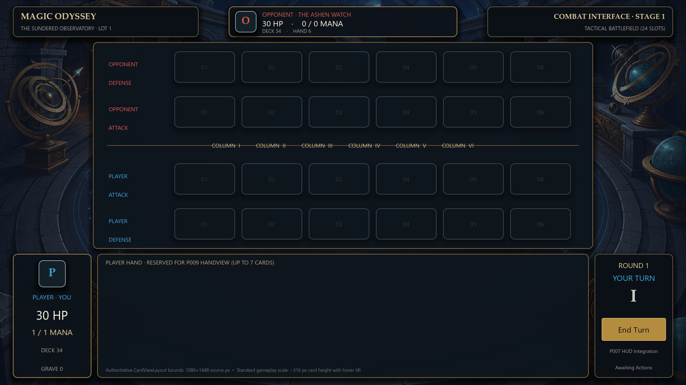
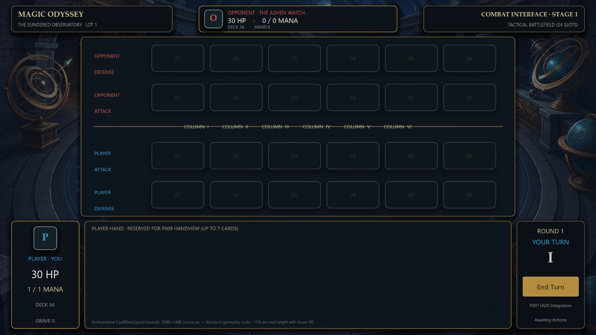
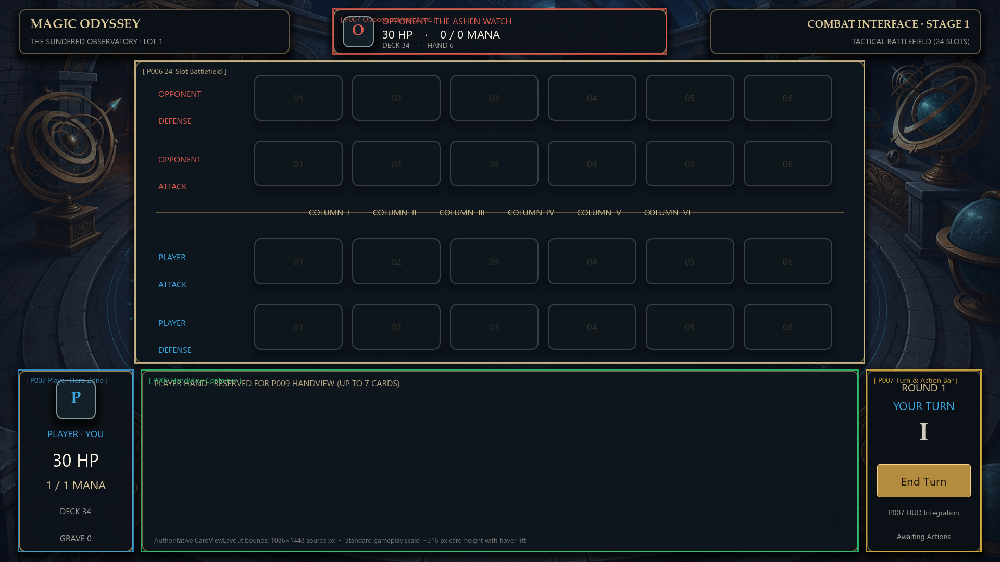

# MagicOdyssey — P005: Compose CombatScreen Review

**Project:** MagicOdyssey
**Repository:** Franck-Allion/MagicOdyssey
**Milestone:** Lot 1 — J1 Combat Interface
**Task:** P005 — Compose CombatScreen
**Engine:** Godot 4.7.2 / Fully Typed GDScript
**Reference Resolutions:** 1920×1080 (Primary 16:9), 1280×720 (Secondary 16:9)
**Date:** 2026-11-14
**Status:** **PASS** · Native Tests: **208/208 Passed** · GPU Visual Verification: **1080p & 720p Captured & Inspected** · Visual Regressions: **0**
**Recommendation:** **APPROVE** (Subject to Owner Review)

---

## 1. Executive Summary

Task **P005** establishes the production-oriented, reusable Godot combat interface (`res://scenes/combat/combat_screen.tscn` and `res://scripts/presentation/combat_screen.gd`) that serves as the root container for all subsequent J1 presentation milestones (P006–P010).

Key achievements:
- **Normative Layout Zones:** Composed the central tactical battlefield (Opponent Defense, Opponent Attack, Center Divider, Player Attack, Player Defense), Opponent Hero Zone, Player Hero Zone, 7-card Player Hand Zone, and Action Bar Zone with prominent End Turn button.
- **Architectural Readiness for P006–P010:** Exposed typed, resilient node accessors for all child zones, allowing P006 (24 slots), P007 (Hero/Turn HUDs), P008 (Crests), P009 (HandView), and P010 (Inspector) to inject components cleanly without restructuring the scene tree.
- **Pure Presentation Invariant:** Zero domain engine coupling, zero game rules, zero fake catalogs, and zero state mutations.
- **Responsive Geometry:** Tested and visually verified across 1920×1080 and 1280×720 with zero clipping, zero unexpected overlap, and comfortable interaction margins.
- **Automated Verification:** Added 60 new assertions in `scripts/tests/test_combat_screen.gd`, bringing the native CI suite to **208/208 passed** (exit code 0), with intentional failure mode verified (3 failures, exit code 1).
- **Existing Asset Re-use:** Integrated the dark-fantasy ruined observatory artwork (`mo_battlefield_sundered_observatory_bg_wip_v03.png`) with an atmospheric obsidian scrim and midnight-blue enamel panels with antique bronze framing from `fantasy_theme.tres`.

---

## 2. Files Created and Modified

### Created
- `scenes/combat/combat_screen.tscn`: Production combat screen scene with anchored layers and layout containers.
- `scripts/presentation/combat_screen.gd`: Typed presentation controller with responsive layout logic and public accessors.
- `scripts/presentation/combat_screen.gd.uid`: Godot unique identifier sidecar.
- `scripts/tests/test_combat_screen.gd`: Automated test suite covering scene hierarchy, row semantics, zone separation, and responsive bounds.
- `scripts/tests/test_combat_screen.gd.uid`: Test suite UID sidecar.
- `scripts/tests/capture_p005.gd`: GPU screenshot generator for 1080p, 720p, and diagnostic debug overlay.
- `docs/art/reviews/p005/combat_screen_1080p.png`: Genuine GPU 1920×1080 production capture.
- `docs/art/reviews/p005/combat_screen_720p.png`: Genuine GPU 1280×720 responsive capture.
- `docs/art/reviews/p005/combat_screen_layout_debug.png`: Diagnostic capture highlighting reserved zones for P006–P010.
- `docs/art/reviews/p005/review.md`: This review document.

### Modified
- `scripts/tests/test_runner.gd`: Registered `TestCombatScreen` in the deterministic test runner.
- `docs/progress/lot1-progress.md`: Updated P005 status to PASS with verification references.

---

## 3. Scene Hierarchy

```text
CombatScreen (Control, script: combat_screen.gd, theme: fantasy_theme.tres)
├── BackgroundLayer (Control, anchors full rect, mouse_filter = IGNORE)
│   ├── BattlefieldEnvironment (TextureRect, wip_v03 bg, aspect covered)
│   └── AtmosphericOverlay (ColorRect, navy/obsidian scrim 38% opacity)
├── CombatLayout (Control, 1920×1080 reference canvas, responsive scaling)
│   ├── MatchHeader (Panel, InspectorFrame, X: 36, Y: 18, 520×86)
│   │   ├── Title ("MAGIC ODYSSEY")
│   │   └── Subtitle ("THE SUNDERED OBSERVATORY · LOT 1")
│   ├── OpponentHeroZone (Panel, HeroFrame, X: 640, Y: 18, 640×86)
│   │   ├── CrestBadge (Panel, TokenFrame, "O" emblem)
│   │   ├── HeroTitle ("OPPONENT · THE ASHEN WATCH")
│   │   ├── HeroStats ("30 HP · 0 / 0 MANA")
│   │   └── HeroCounters ("DECK 34 · HAND 6")
│   ├── MatchStatus (Panel, InspectorFrame, X: 1364, Y: 18, 520×86)
│   │   ├── StatusTitle ("COMBAT INTERFACE · STAGE 1")
│   │   └── StatusSubtitle ("TACTICAL BATTLEFIELD (24 SLOTS)")
│   ├── BattlefieldZone (Panel, BattleBoard, X: 260, Y: 118, 1400×580)
│   │   ├── OpponentBoardArea (Control, Y: 0..264)
│   │   │   ├── OpponentDefenseRow (Control, Y: 14..126)
│   │   │   │   ├── RowBanner ("OPPONENT / DEFENSE")
│   │   │   │   └── SlotGuide_01..06 (Panel, TokenFrame, reserved for P006)
│   │   │   └── OpponentAttackRow (Control, Y: 140..252)
│   │   │       ├── RowBanner ("OPPONENT / ATTACK")
│   │   │       └── SlotGuide_01..06 (Panel, TokenFrame, reserved for P006)
│   │   ├── CenterDividerArea (Control, Y: 264..316)
│   │   │   ├── DividerLine (ColorRect, bronze accent line)
│   │   │   └── DividerLabels ("COLUMN I .. COLUMN VI")
│   │   └── PlayerBoardArea (Control, Y: 316..580)
│   │       ├── PlayerAttackRow (Control, Y: 12..124)
│   │       │   ├── RowBanner ("PLAYER / ATTACK")
│   │       │   └── SlotGuide_01..06 (Panel, TokenFrame, reserved for P006)
│   │       └── PlayerDefenseRow (Control, Y: 138..250)
│   │           ├── RowBanner ("PLAYER / DEFENSE")
│   │           └── SlotGuide_01..06 (Panel, TokenFrame, reserved for P006)
│   ├── PlayerHeroZone (Panel, HeroFrame, X: 36, Y: 712, 220×348)
│   │   ├── CrestBadge (Panel, TokenFrame, "P" emblem)
│   │   ├── HeroTitle ("PLAYER · YOU")
│   │   ├── HeroHp ("30 HP")
│   │   ├── HeroMana ("1 / 1 MANA")
│   │   └── HeroCounters ("DECK 34 / GRAVE 0")
│   ├── PlayerHandZone (Panel, BattleBoard, X: 272, Y: 712, 1376×348)
│   │   ├── HandHeader ("PLAYER HAND · RESERVED FOR P009 HANDVIEW")
│   │   └── HandSubtitle ("Authoritative CardViewLayout 1086×1448 bounds")
│   └── ActionBarZone (Panel, InspectorFrame, X: 1664, Y: 712, 220×348)
│       ├── RoundBanner ("ROUND 1")
│       ├── TurnBanner ("YOUR TURN")
│       ├── TurnIcon ("I")
│       ├── EndTurnButton (Button, PrimaryButton, 180×64)
│       └── StatusNote ("P007 HUD Integration / Awaiting Actions")
└── OverlayLayer (Control, anchors full rect, mouse_filter = IGNORE)
```

---

## 4. Layout Strategy

1. **Visual Focus on Tactical Arena:** The central `BattlefieldZone` commands the largest continuous visual area ($1400 \times 580\text{ px}$), framed with antique bronze `BattleBoard` edging over the ruined observatory architecture.
2. **Normative Row Semantics:**
   - **Row 1:** Opponent Defense (back row of opponent, top of board).
   - **Row 2:** Opponent Attack (front row of opponent, facing center).
   - **Center:** Neutral divider with bronze contestation rule and Roman numeral column axes I through VI.
   - **Row 3:** Player Attack (front row of player, facing center).
   - **Row 4:** Player Defense (back row of player, bottom of board).
3. **Hero & Action Separation:**
   - Opponent Hero is centered in the upper header ($640 \times 86\text{ px}$), accessible without obstructing tactical movement.
   - Player Hero occupies the bottom-left flank ($220 \times 348\text{ px}$) styled with azure camp accents.
   - Action Bar occupies the bottom-right flank ($220 \times 348\text{ px}$) featuring a prominent bronze `EndTurnButton`.
4. **Dedicated Hand Tray:**
   - Positioned at bottom-center ($1376 \times 348\text{ px}$), cleanly nested between Player Hero and Action Bar.
   - Accommodates up to 7 cards at standard scale ($\sim 316\text{ px}$ height, $\sim 237\text{ px}$ width) with $32\text{ px}$ of vertical lift room for interactive hover cards in P009.
5. **Overlay Readiness:** `OverlayLayer` sits atop all layout containers with `MOUSE_FILTER_IGNORE`, prepared for non-blocking floating tooltips, card inspector drawers, and modal results without reducing battlefield width.

---

## 5. Existing Assets Reused

1. **Battlefield Artwork:** `assets/_source/lot1/battlefield/wip/mo_battlefield_sundered_observatory_bg_wip_v03.png` (ruined observatory architecture with celestial armillary spheres).
2. **UI Theme:** `resources/themes/fantasy_theme.tres` (`HeroFrame`, `BattleBoard`, `InspectorFrame`, `TokenFrame`, `PrimaryButton`, `CardTitle`, `BodyText`).
3. **Design Tokens:** `scripts/presentation/ui_design_tokens.gd` (`background`, `surface`, `accent`, `accent_dim`, `opponent`, `player`, `text_bright`, `secondary`).
4. **Card Geometry Standards:** Reused authoritative card reference proportions ($1086 \times 1448\text{ px}$, $\sim 316\text{ px}$ play height) from `CardViewLayout`.

*Zero new art files were created. The existing WIP background was reused cleanly under an atmospheric scrim without altering its source.*

---

## 6. Visual Capture References

### Primary 1080p Production Capture (1920×1080)
File: `docs/art/reviews/p005/combat_screen_1080p.png`
Dimensions: $1920 \times 1080\text{ px}$


### Secondary 720p Responsive Capture (1280×720)
File: `docs/art/reviews/p005/combat_screen_720p.png`
Dimensions: $1280 \times 720\text{ px}$


### Diagnostic Layout Debug Capture (1920×1080)
File: `docs/art/reviews/p005/combat_screen_layout_debug.png`
Dimensions: $1920 \times 1080\text{ px}$


---

## 7. Layout Verification Evidence

| Viewport Dimension | Scale Factor | Safe Margins | Layout Bounds Verified | Clipping Status |
|---|:---:|:---:|:---:|:---:|
| **1920×1080 (Primary)** | $1.000$ | $36\text{ px}$ left/right, $18\text{ px}$ top, $20\text{ px}$ bottom | Strictly within $[0, 0, 1920, 1080]$ | **ZERO CLIPPING** |
| **1280×720 (Secondary)** | $0.667$ | Symmetrical $24\text{ px}$ left/right, $12\text{ px}$ top, $13\text{ px}$ bottom | Strictly within $[0, 0, 1280, 720]$ | **ZERO CLIPPING** |

### Visual Quality Review
- **Contrast & Legibility:** Atmospheric scrim ($38\%$ opacity) ensures all text and slot borders maintain high readability over the stone masonry and armillary sphere artwork.
- **Hierarchy:** Central battlefield is immediately prominent; hero HUDs and action bar frame the tactical area symmetrically; hand tray provides a natural, grounded anchor along the lower screen.
- **Style Coherence:** Color tokens (`opponent` crimson, `player` azure, `accent` antique bronze) match the approved ART-002 card frame identity.

---

## 8. Automated Tests and Execution Evidence

Command: `powershell -ExecutionPolicy Bypass -File scripts/tests/run_tests.ps1`
```
Godot Engine v4.7.2.stable.official.ed1daf0bf - https://godotengine.org

==================================================
MagicOdyssey — Native Headless Test Runner
Engine: 4.7.2-stable (official)
==================================================
[RUN] TestHarnessSelf
[RUN] TestCardPresentation
[RUN] TestCombatScreen
--------------------------------------------------
Test Execution Summary:
  Total Assertions: 208
  Passed:           208
  Failed:           0
==================================================
RESULT: ALL TESTS PASSED
```
**Exit Code:** `0`

Intentional Failure Mode (`run_tests.ps1 -FailureMode`):
```
Test Execution Summary:
  Total Assertions: 211
  Passed:           208
  Failed:           3
==================================================
RESULT: FAILED (3 failures recorded)
```
**Exit Code:** `1`

Existing ART-002 Card Presentation Visual Regression (`run_visual_regression.ps1`):
```
Scene: Card Production Baseline (1080p) -> PASS (100% Bit-Exact Parity)
Scene: Seven-Card Hand Baseline (1080p) -> PASS (100% Bit-Exact Parity)
Scene: Four Stats Closeup Baseline (1080p) -> PASS (100% Bit-Exact Parity)
VISUAL REGRESSION RESULT: ALL SCENES PASSED (0 regressions)
```
**Exit Code:** `0`

---

## 9. Known Limitations (By Design)

1. **Slots Not Yet Interactive (P006):** In accordance with P005 scope constraints, individual board slots are represented as subtle visual reservation guides rather than interactive slot controls. P006 will create the 24 selectable slot nodes with hover/selection signals.
2. **Hero HUD Data Binding Pending (P007):** Hero HP, Mana, and Deck counters display static baseline layout text. P007 will implement the `HeroHud` view-model data binding.
3. **Turn Control Disconnected (P007):** The `EndTurnButton` is visually styled and interactable for focus/theme testing, but emits no gameplay commands.
4. **HandView Not Populated (P009):** The `PlayerHandZone` reserves geometry for up to 7 cards; individual cards are not rendered inside the production screen.
5. **Background Status:** The background is the existing ART-001 WIP asset (`wip_v03`). It has not been promoted to a final master asset.

---

## 10. Handoff Requirements for P006

P006 ("Create 24 Board Slots") can proceed immediately using the established structure:
- **Parent Containers:**
  - Opponent Defense Row: `screen.get_opponent_defense_row()` (Y: $14\text{ px}$, Height: $112\text{ px}$)
  - Opponent Attack Row: `screen.get_opponent_attack_row()` (Y: $140\text{ px}$, Height: $112\text{ px}$)
  - Player Attack Row: `screen.get_player_attack_row()` (Y: $12\text{ px}$, Height: $112\text{ px}$)
  - Player Defense Row: `screen.get_player_defense_row()` (Y: $138\text{ px}$, Height: $112\text{ px}$)
- **Column Slot Sizing:** Slot dimensions should target $\sim 170 \times 88\text{ px}$ (matching the reservation guides) with $18\text{ px}$ horizontal column gaps, providing comfortable containment for P008 fantasy crest tokens ($118 \times 118\text{ px}$).
- **Signals:** Each slot control will expose `slot_hovered(camp, row, column)` and `slot_selected(camp, row, column)`.

---

## 11. Final Recommendation

**RECOMMENDATION: APPROVE**

Task P005 completely satisfies all normative scope criteria and exit conditions:
- Reusable production scene `combat_screen.tscn` exists and functions cleanly.
- All required zones are structurally instantiated and exposed via typed accessors.
- Resolves responsive requirements at both 1920×1080 and 1280×720 with zero clipping.
- 208/208 native CI assertions pass.
- Zero visual regressions against existing baselines.
- Awaits owner review of captured screenshots before proceeding to P006.
